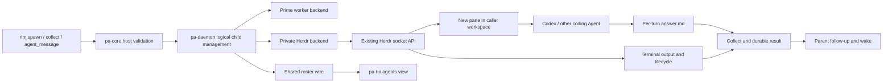
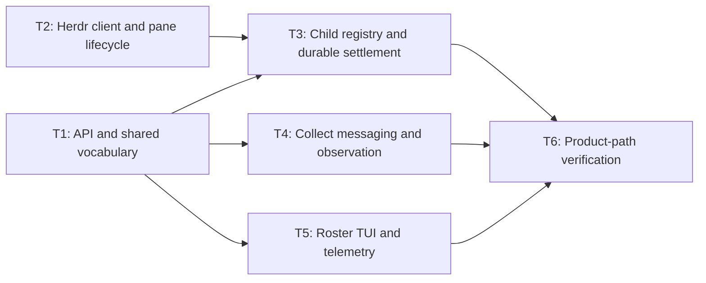

# RFC-0001: 通过 Herdr 管理原生外部 Subagent

## 摘要

扩展 Prime Agent 的原生 subagent 管理，让 `rlm.spawn` 可以选择 Codex 等外部 coding agent。Prime 通过 Herdr 现有 socket API，在调用会话所在的 workspace 中创建一个独立 pane，启动外部 agent，并将其纳入原生名册、结果收集、消息发送和父会话通知。所有实现位于 Prime Agent 仓库。

## 动机

现有 `herdr-subagent` Python skill 已实现可见外部 agent 的执行闭环：同 workspace 创建 pane、启动真实 agent、通过每轮独立的 `answer.md` 回传答复、在后台等待结束并用 `rlm.notify` 唤醒父会话。它还支持同会话追问与 pane 控制，但维护独立 registry，尚未进入 Prime 的原生子会话名册、消息寻址和结算流程。

用户需要直接在 Prime 中派发外部 coding agent，同时在同一个 Herdr workspace 看到它的运行过程。Herdr 已统一提供 pane 分屏、agent 启动、输入、状态观察和终端读取；Prime 应复用这些能力，使后续接入其他 Herdr 支持的 agent 时无需为每一种 agent 实现进程管理。

## 设计

### 概述

Prime 保留统一的逻辑 subagent 身份和父子关系，在 daemon 内组合两个执行后端：现有 Prime worker 后端，以及新的 Herdr 后端。后端选择只影响执行与观察；名字、child ID、名册、collect 和父通知仍由 Prime 管理。

复用 `herdr-subagent` 已验证的约定：给每轮任务分配独立的 `turns/<n>/answer.md`，在简短任务前言中要求子 agent 把最终答复写入该路径。Herdr 负责运行与生命周期，答复文件负责完整结果回传，终端读取负责观察与排错。后台观察与通知迁入 daemon；外部任务完成后，父 agent 自动收到可处理的通知，用户可以直接操作新 pane。

### 用户接口

| 接口 | 契约 |
| --- | --- |
| `rlm.spawn` | 增加可选 `agent` 和 `agent_args`。省略 `agent` 或指定 `prime` 使用 Prime；其他值是 Herdr agent kind，例如 `codex`、`claude`、`gemini`。 |
| `agent_args` | 可选字符串数组，原样交给 Herdr 的 `agent.start.args`；不拼接 shell 命令。只适用于外部后端。 |
| `worktree` / `base` | 外部后端支持 `worktree=True` 自动创建唯一分支，或字符串指定分支；`base` 选择起点，默认 HEAD。未启用 worktree 时禁止 base；Prime worker 后端明确拒绝 worktree。 |
| `model` / `thinking` | 继续属于 Prime 模型选择契约。外部后端使用其自身配置；显式传入这些参数时报清楚的参数错误，提示使用对应 agent 的 `agent_args`。 |
| spawn handle | 保留逻辑 child ID、名字和 artifacts 目录，增加 backend/agent 信息。外部实际模型未知时为 `None`，不填入猜测的模型名。 |
| `rlm.list_subagents` | 返回两个后端的统一列表，外部项附带 Herdr 引用及 runtime state。 |
| `rlm.collect` | 按现有名字、child ID 或 handle 选择子会话，支持本轮结果与有界等待。`answer_text` 来自本轮答复文件；附带 `answer_path` 和明确的截断信息，终端 `output` 作为独立过程证据。 |
| `agent_message.send` | 给空闲外部子会话发送后续任务，在同一个 pane 和同一个外部会话继续。每个外部子会话同时只允许一轮；忙碌或 blocked 时明确拒绝。 |
| `agent_observe` | 名册和状态覆盖外部子会话；观察内容明确标记为终端证据，不将屏幕文本伪装为结构化 assistant 消息。 |
| `/agents` | 显示 backend、agent kind 和运行状态；打开外部子会话时定位其 Herdr pane，回复继续使用统一消息路由。 |
| `rlm.delete_subagent` | 与现有原生删除操作一样，可以终止并删除子会话；只关闭本子会话拥有且身份仍匹配的 pane。名册的 inactive 清理继续跳过运行中任务。 |

两个 Python spawn facade、host 参数验证和类型解析一起更新。未选择外部后端的调用保留现有请求和结果语义。新增信息按 backend 分支严格校验，避免较旧 host 静默忽略外部请求。

### 同 workspace 创建 pane

1. 从调用会话保存的 client context 获取 Herdr socket 和 pane 身份。禁止读取共享 daemon 启动时的 pane 环境来决定目标。
2. 查询并验证调用 pane 当前所在的 workspace、tab 和 terminal 身份；以此确定本次 spawn 的 workspace。缺少有效 Herdr context 时，外部 spawn 明确失败。
3. 使用 `pane.layout` 获取几何信息，默认在调用 pane 所在 tab 创建相邻 pane。宽屏优先向右，较窄布局向下；使用显式目标 pane、workspace、父会话 cwd 和 `focus=false`。
4. 校验新 pane 的 workspace 与本次目标一致，保存响应中的真实 pane ID 和 terminal ID。创建过程不切换用户焦点。
5. 使用 `agent.start` 启动指定 kind。Herdr 的全局 agent 名由稳定 child 身份派生，满足其字符和长度约束；Prime 中的任务名仍使用原生名字规则。
6. Herdr 确认 agent 可接受输入后，才发送本轮任务。先记录轮次和状态基线，再执行 `agent.prompt`。

spawn 先验证参数并保留唯一 child 名字，创建 pane 后将真实 pane 身份和 starting 状态持久化，再等待 `agent.start` 确认可接受输入，然后返回 handle；任务运行与结果等待在后台进行。它不会等待模型完成任务，但分屏和启动本身可能需要数秒。启动失败直接报告给调用者并保留可检查记录；已返回 handle 的运行故障通过同一子会话结果和父通知报告。

正常完成保留 pane 和外部会话，方便查看与追问。启动失败时，只有尚未运行目标 agent、仍符合本次创建身份的空 pane 可以自动回收；存在 blocked 界面或已经启动的进程时保留 pane，并在错误中说明。清理失败必须可见。

### Worktree 扩展（2026-11-10）

显式启用 worktree 时，复用 Herdr 的 `worktree.create` API，以父会话 cwd 确定仓库。
Herdr 为 checkout 建立独立 workspace 和 root pane；普通 spawn 继续在父 workspace 分屏。
两种模式都使用 focus=false。自动分支为 `task/<child-id>`，显式分支和 base 按原值传递，
Herdr 的 Git 错误直接呈现。创建请求的未知结果不重试，也不改为在父 checkout 执行。

校验响应中的 linked-worktree 标志、分支、绝对 checkout/repository 路径、workspace
membership 和 root-pane 身份。返回的 `external.worktree` 包含 path、branch、repo_root，
随 manifest 持久化，并在 handle、list、collect 和 roster 中保留。旧 manifest 没有该字段时
表示原有普通 pane；存在但损坏的 metadata 明确报错。

追问复用外部进程及其 worktree。结果仍写入父会话 artifacts 中的独立 turn 目录，
外部 agent 的权限需允许写入该路径。Prime 不自动修改 agent 的 sandbox/approval 参数。
正常完成保留 pane；显式关闭、删除或父会话清理只终止所属 pane，保留 checkout、分支及修改，
不自动执行 worktree.remove。用户可以检查、合并后再通过 Herdr/Git 清理 checkout。

### Herdr 客户端与状态观察

在 `pa-daemon` 内新增私有、带类型的 Herdr JSON-lines socket 客户端。复用现有异步 I/O 和 JSON 依赖，不通过 shell 包装 CLI。现有生命周期 reporter 保持其报告职责；新客户端拥有完整响应解析、request ID 校验、错误处理、超时和事件订阅。

使用现有 `pane.split/layout/get/close`、`agent.start/get/prompt/read/send_keys/focus`、`events.subscribe` 等方法。按响应形状和所需能力检查兼容性；缺少字段、未知错误响应、协议不兼容或输出读取失败都作为显式错误处理，不退回屏幕猜测或另一个执行后端。

订阅建立后读取状态基线，事件只负责触发新的权威 `agent.get` 读取。断线后显式进入 recovering，重新订阅并核对身份和状态；有界重连失败后报告错误。整个流程在后台运行，不阻塞 TUI paint。

每轮记录独立 `turn_id`、起始 `state_change_seq` / `completion_seq` 和通知状态。只有任务发送后观察到对应生命周期变化，并进入新的有效完成状态，才可以结束本轮；不能用启动后的原有 idle 状态结算新任务。

| Herdr 观察 | Prime 行为 |
| --- | --- |
| starting / working | 子任务未完成，继续观察。 |
| 新的 idle / done 完成 | 读取本轮非空答复文件，保存结果后再发送父完成通知；文件缺失、为空或读取失败则报告 error。 |
| blocked | 保持未完成，保存输出并通知父会话需要用户处理；不自动回答审批或问题。 |
| unknown | 显示无法识别，保持未完成；不能视为成功。持续无法确认时报告可诊断的观察错误。 |
| pane 关闭、agent 退出或被替换 | 核对身份后报告 error/cancelled，不将无输出当成成功。 |

Herdr 的 idle/done 展示与用户是否看过 tab 有关。完成判定使用生命周期序列和当前轮次，不依赖焦点或展示标签。跨 pane 移动通过稳定 terminal 身份和受控 agent 名跟踪；不以旧 pane ID 操作可能已经变化的目标。无法唯一确认身份时停止发送输入和清理，并显式报告。

### 答复文件、输出与 collect

每次 spawn 或后续消息投递前创建独立 turn 目录，将本轮答复文件的绝对路径放入简短前言；每轮都重新注入，避免追问仍写旧文件。原生接口默认始终提供这条结果回传约定，最终答复格式为 UTF-8 文本/Markdown。

正常完成同时要求本轮已进入有效结束状态，以及当前轮次的答复文件存在、可读且非空。文件先于状态结束出现时继续等待任务结束；状态结束但缺失答复文件时明确报告 error。读取具体文件的 I/O、编码、类型和路径错误均保留原因，不把终端尾部填成最终回答。

`answer_text` 与 `answer_preview` 来自该文件，`answer_path` 指向完整 artifacts。沿用宿主的结果大小上限，并显式返回 `answer_truncated` 等信息；完整文件保留供后续检查。只读取本轮拥有的路径，不接受旧轮次文件替代，不通过固定 sleep 和重试文件读取来掩盖任务违反回传约定。

外部子任务的观察 `output` 包含：`kind=terminal`、`text`、`source`、`revision`、`truncated`、`turn_id`、`pane_id` 和 `agent_kind`。空闲时读取 `recent_unwrapped`；工作、阻塞或未知状态读取 `visible`，避免 Herdr 为捕获历史滚动正在使用的界面。去除 ANSI，并保存返回的实际来源与截断信息。

终端输出可能包含多轮历史、工具执行内容或当前屏幕。即使 `truncated=false`，也只表示这次 Herdr 读取未发生相应截断，不表示获得完整对话。模型提示和 UI 保持这一语义，最终回答始终来自答复文件。需要更多现场信息时，父 agent 可以继续观察，用户也可以打开 pane。

在结果大小限制处同时保存证据路径、Herdr 截断信息与 Prime 自身截断信息，禁止把宿主截断隐藏成完整输出。任何读取或持久化失败都显示具体错误，不以空文本完成任务。

答复先写入本轮结果，再走现有父会话 follow-up 通知和唤醒通道。外部完成通知包含 child ID、轮次、状态、答复路径、简短摘要及 collect 指引。保留父回合结束、goal/quiescence 和子任务结算的既有顺序，避免父 agent 被唤醒时还读不到答复。daemon 后端直接使用原生通知通道，不依赖 Python watcher 的 bash handle 或 bash 完成通知。

### 身份、消息与界面

外部子会话具有 Prime 分配的逻辑 child ID、父身份和 artifacts 目录，同时保存独立 `HerdrRef`：socket、workspace、pane、terminal、agent kind、受控 agent 名及可用的外部 session 引用。不创建假的 Prime worker、active session ID 或 Prime session JSONL。

两个后端共享名字保留和 child ID 分配。daemon 的列表、collect、running/close、family 寻址及 roster 投影合并两类子会话；现有 Prime `ChildRecord` 和使用量统计保留在其原有后端中。共享 wire/domain 类型放在 `pa-types`，后端实现保持私有。

消息路由先识别外部逻辑 child，走 `agent.prompt`；Prime 子会话继续走原有 worker 传输。外部消息回执明确标注终端输入投递，不声称外部 agent 已处理或支持 Prime kernel API。外部完成、阻塞和故障由 daemon 自动转为父通知；任意时刻从外部主动调用 Prime 的 Python 消息 API 不属于这一执行后端的能力。

如果 prompt 请求发送后连接断开，无法确认是否已经输入，记录为 delivery-uncertain 并通知父会话，不能自动重发。原生 worker 通过 kickoff session row 判断是否已送达的重试逻辑不适用于外部终端。

外部名册行使用真实的 runtime residency，不能因为没有 activeSessionId 就标为 inactive。TUI 只读取 wire 字段并请求 daemon 执行 focus/控制操作，不直接连接 Herdr 或引入 session engine 依赖。未知的模型、token、费用及工具计数显示为不可用，不记成零或纳入 Prime 的模型费用。

### 持久化与清理

在父会话 artifacts 中保存独立的外部子会话 manifest 和每轮证据，包括 admission、Herdr 身份、轮次基线、结果、通知投递状态与删除记录。写入原子化，读取严格校验版本与必需字段；损坏记录直接报告，不作为空 registry 继续运行。

Supervisor 重启时，由仍存活的父 worker 继续观察。父 worker 恢复时读取 manifest，重新验证 Herdr pane/agent 身份并接续观察；不能自动重发已投递的 prompt 或另建外部会话。身份丢失时保留历史并标记错误。通知采用稳定的 child/turn 事件身份和可恢复的投递记录，避免重连事件造成重复唤醒；不能把投递失败记录为成功。

删除、停止和父会话 teardown 通过统一生命周期操作处理。所有破坏性操作先核对保存的 terminal/agent 身份，只作用于 Prime 为该 child 创建的资源。pane 被替换、移动后无法唯一确认或用户已接管其他进程时，返回清理冲突并保留可重试状态，不能关闭其他 pane。取消和自然完成竞态以本轮状态机决定唯一终态。

显式停止外部子会话以关闭其所属 pane 为终止边界；确认资源终止后记录 cancelled。通用按键投递本身不是任务已经停止的证据，不以发送 Ctrl-C 的成功回执宣称取消完成。

### Telemetry 与性能

新增版本化的 `external subagent started` / `external subagent completed` adoption events，属性仅含 backend、受约束 agent kind、状态、耗时和输出是否截断等原语。不得携带 prompt、终端文本、路径、pane/session 标识或自由错误文本。

事件由后台 telemetry worker 发送。Herdr 连接、启动、输出持久化和重连均不得进入 TUI first paint 或每帧等待路径。包含挂起的 Herdr/telemetry sink 验证，确保故障只影响后台任务。

### 架构图

## 权衡取舍

### 考虑过的替代方案

- **在 Python skill 中继续管理外部任务**：适合独立工具，但会重复维护原生名册、消息和结算逻辑，无法满足统一 subagent 界面与可见 pane 的目标。
- **Prime 为每个外部 CLI 实现专用进程和 transcript 适配**：可以拿到更丰富的专用数据，但每种 agent 都需要独立生命周期逻辑；本方案复用 Herdr 的统一接口。
- **将外部 agent 伪装成 Prime worker session**：会错误地承诺 kernel、消息、模型统计和 session attach 能力；本方案使用真实的后端身份和能力。

### 限制

外部 agent 必须能写入本轮指定的答复路径；其权限或沙箱配置阻止写入时，任务明确失败。该约定提供最终答复，不提供完整结构化对话。终端过程证据的范围仍受 agent 的 TUI 与 Herdr 缓冲区影响。外部实际模型、费用和主动 Python 回调不由通用 Herdr 终端接口提供。每个外部子会话同时执行一轮，审批仍在其可见 pane 中由用户处理。

## 实现计划

### 阶段划分

- [x] 建立后端身份、spawn、每轮答复文件与终端证据契约。
- [x] 接入 Herdr pane 和运行生命周期，再统一名册、消息与结果。
- [x] 完成可见 UI、telemetry 和真实端到端验证。

实现与完整验证结果见 [验证记录](0001-herdr-subagents-verification.md)，原生行为的 TS 对照见
[差分证据](0001-herdr-subagents-parity.md)。全量仓库门禁的已有失败在验证记录中单独列明。

### 子任务分解

| ID | 标题 | 依赖 | Ref |
| --- | --- | --- | --- |
| T1 | API 与共享后端词汇 | - | - |
| T2 | Herdr 客户端及 pane 生命周期 | - | - |
| T3 | 子会话注册、持久化与结算 | T1, T2 | - |
| T4 | Collect、消息与观察路由 | T1 | - |
| T5 | 名册、TUI 与 adoption telemetry | T1 | - |
| T6 | 产品路径与兼容性验证 | T3, T4, T5 | - |

**T1: API 与共享后端词汇**
- **范围**：Python 两处 spawn facade、host 参数验证、后端与 Herdr 引用类型、答复文件与终端输出类型、能力和兼容性说明，保持提示词简短。
- **验收标准**：原有 Prime 调用通过既有测试；外部参数与结果严格校验；不支持的 model/thinking、混用参数和旧 host 不会静默执行另一种任务。

**T2: Herdr 客户端及 pane 生命周期**
- **范围**：私有 socket 客户端、响应/订阅、session context、布局与分屏、agent 启动和输入、身份验证与受控清理。
- **验收标准**：测试服务器验证显式 workspace/cwd/focus=false；畸形响应、超时、错误、agent 被替换及创建失败可见；无 shell 插值；不操作非本任务资源。

**T3: 子会话注册、持久化与结算**
- **范围**：组合 Herdr backend、跨后端名字与 ID、admission、轮次状态机、结果持久化、父通知、恢复与 teardown。
- **验收标准**：旧 idle、乱序/重复事件和断线不会误完成；blocked 不结算；输出先于通知可见；恢复不重复派任务；清理冲突和通知失败保留可诊断状态。

**T4: Collect、消息与观察路由**
- **范围**：合并列表/collect、family 选择器、后续任务投递、外部观察输出与边界。
- **验收标准**：name/ID/handle 选择一致；外部 collect 从本轮答复文件取得 answer_text，缺失/空白/读取失败不降级成屏幕答案；答复与终端证据各自携带截断信息；忙碌追问明确失败；同一 pane 的下一轮结果与上一轮隔离；原生 worker 消息路径回归通过。

**T5: 名册、TUI 与 adoption telemetry**
- **范围**：外部 residency 投影、状态与输出显示、打开 pane、回复/停止/删除控制及版本化事件。
- **验收标准**：无需伪造 active session；在 `/agents` 可找到并打开外部子会话；未知费用不污染统计；挂起 Herdr 或 telemetry 不延迟 paint；事件不包含内容或标识数据。

**T6: 产品路径与兼容性验证**
- **范围**：受隔离环境控制的真实 Herdr + Codex 产品路径、故障和恢复验证、原生兼容性证据与人工步骤。
- **验收标准**：同 workspace 新 pane、后台任务完成唤醒、collect 证据、原会话追问与 owner-only 删除完整贯通；测试不会触碰用户已有 pane；项目检查和相关原生 parity verifier 通过。

### 影响范围与所有权

| 模块 | 职责 |
| --- | --- |
| `prime-agent-runtime/src/rlm/` | Python API 与严格结果解析。 |
| `crates/pa-types/src/daemon/` | 跨 crate 的 backend/runtime 引用、输出及控制 wire 类型。 |
| `crates/pa-core/src/session_engine/rlm_host.rs` 与观察接口 | 参数验证和 host 契约，不管理外部进程或 UI。 |
| `crates/pa-daemon/src/rlm_children/` 及新私有 Herdr backend 模块 | 子会话、Herdr 传输、资源所有权、状态、持久化和父通知。 |
| `crates/pa-daemon/src/agent_messaging/`、roster 模块 | 外部寻址、观察与统一名册投影。 |
| `crates/pa-tui/src/agents_view/` 与 wire client | 从 wire 渲染、请求 focus/控制操作。 |
| `crates/pa-telemetry/` | 版本化 adoption schema 与 typed events。 |
| 提示词、crate README 与测试 | 精简 API 说明、能力边界和产品路径证据。 |

本变更包含新增 public/wire surface，需要按架构变更评审。依赖方向遵循现有 Crates 表；共享词汇只放 `pa-types`，不新增跨 crate re-export，也不计划增加第三方依赖。已有大文件中的新增职责拆到邻近私有模块。

## 测试方案

### 单元与组件测试

- Python/host：默认请求兼容、外部 kwargs、未知模型值、非法输出字段与 backend 分支。
- Herdr 客户端：request ID/错误响应、分片行、连接断开、订阅和状态读取交错、显式 timeout。
- 轮次状态机：旧 idle、极快完成、重复事件、用户聚焦引起 done/idle 变化、blocked、unknown、pane 消失、取消与完成竞态。
- 数据流：答复文件缺失、空白、旧轮次文件、文件先于 idle 写出、I/O/编码错误、读取/写入失败、答复与终端证据截断、损坏 manifest、恢复与通知去重；通知失败必须显式可诊断。
- 资源：并发同名任务、同 workspace 校验、agent/pane 替换、移动后的唯一身份验证与清理失败。
- 非阻塞：挂起 Herdr/telemetry endpoint 不阻塞首次绘制与交互。

### 集成测试

通过测试 socket 和真实 daemon worker 验证 spawn → 分屏 → start → prompt → observe → 读取本轮答复文件 → 保存结果 → 父通知 → collect，并覆盖失败分支。测试使用临时目录和可观测 readiness，不用固定 sleep 或 retry-to-green。

真实 Herdr verifier 创建隔离测试 session/workspace，并使测试父会话和子 pane 位于其中同一个 workspace。测试 Codex 完成短任务、同会话追问及删除；阻塞、长输出截断和取消另由 socket fixture 覆盖。记录实际 workspace/pane/terminal、轮次和通知证据。只清理 verifier 创建的资源，检查其资源没有抢占焦点；并发用户导致的其他焦点变化记录为证据，不自动恢复焦点。

运行 `make check`，并在引入依赖时运行 `make deny`。用户可见原生路径提供 TS 对照：名册、消息、通知、选择和既有 wire；Herdr 扩展提供新增契约 verifier，不能将其称为已有 TS 行为。对修改的关键分支补足有效回归测试，覆盖率按仓库门槛执行，缺省以修改代码 80% 为目标。

### 人工验收

1. 在 Herdr 的一个 Prime 会话中 spawn Codex；确认同 workspace 自动新增 pane，cwd 正确，焦点仍在父 pane。
2. 确认 Prime `/agents` 出现同名外部 child，能看到 starting/working 状态并定位它的 pane。
3. 父 agent 结束当前回合后，等待子任务完成；确认子 agent 写入指定 answer.md，父 agent 自动被唤醒，collect 返回对应轮次的答复和文件路径。
4. 向已空闲 child 发送追问，确认复用原 pane/外部会话；上一轮输出不会结算本轮任务。
5. 检查 blocked、输出截断、手工关闭/替换 pane 的错误提示，并验证停止/删除不影响任何已有 pane。
6. 不指定外部 agent 再执行原生 spawn，验证原有名册、消息、完整回答和通知行为。

## 未解决的问题

当前设计无阻塞项。接口与终端证据语义在本 RFC 审阅时一起确认。

## 参考资料

- `crates/pa-core/src/session_engine/rlm_host.rs`：原生 subagent host seam。
- `crates/pa-daemon/src/rlm_children/`：现有 child admission、结算和通知。
- `crates/pa-daemon/src/herdr.rs`：现有 session-scoped Herdr 生命周期报告。
- `crates/pa-types/src/daemon/herdr_env.rs`：client context allowlist。
- `crates/pa-daemon/src/agent_messaging/`：family 消息与观察。
- 本地 `~/.prime/agent/skills/herdr-subagent/`：现有行为参考，尤其是每轮 answer.md、同 pane 追问、detached watcher 与单次通知。2026-11-09 阅读实现并重跑 `tests/check.py`，离线检查通过；`VERIFICATION.json` 另有 Codex/agy 实测记录，本次未重新运行实际 agent。
- Herdr 0.9.5 安装版的 `herdr api schema`、CLI help 与 `herdr status server`，调研于 2026-11-09；实现应检查所需 API 能力，不将 private protocol 22 当作完整公共兼容性保证。
